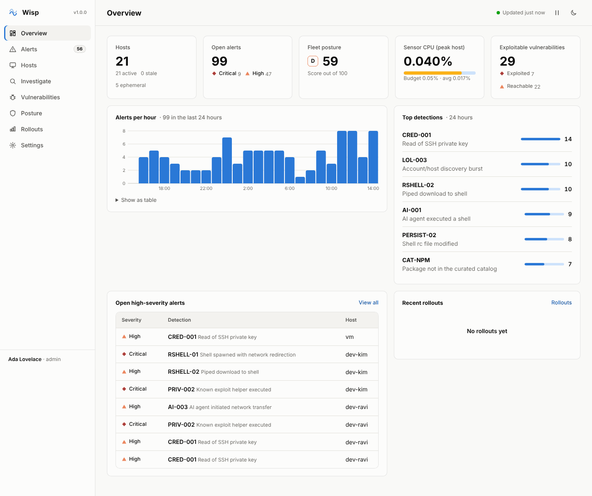

# Wisp

> **Research project.** Wisp is experimental research software, not a
> supported product: there is no security response process and no guarantee
> of fixes. Do not rely on it to protect production systems. See
> [SECURITY.md](SECURITY.md).

**Endpoint detection and response for fleets where code, people and AI agents
all run commands, in under 0.05% of a CPU core.**

Wisp watches every process execution and outbound connection on your Linux
hosts, and works out who is really behind each one: a person, an AI agent, a
build, CI, or a service. It enforces your policy on them and streams
everything to a single fleet console. The sensor holds a **hard,
self-enforced CPU budget of 0.05% of one core** for its userspace process
(measured at 0.03% under a sustained 2,000-exec/s storm, 0.005% idle) and is
not a kernel module. The in-kernel eBPF cost is charged to the processes that
exec and is measured separately ([BENCHMARKS.md](BENCHMARKS.md)).



## What it does

| | |
|---|---|
| **Sees every actor** | an eBPF sensor captures each exec and outbound connection at the moment it happens, and attributes it to *human*, *AI agent*, *code*, *CI* or *service* by walking the process tree |
| **Detects and responds** | rules for credential theft, reverse shells, living-off-the-land, persistence, privilege escalation and risky AI-agent behaviour. In enforce mode it kills or quarantines on the spot |
| **Curates the toolchain** | an enterprise catalog for npm and pip packages (version pinning, block- and allow-lists), IDE extensions (VS Code, Cursor) and AI tools ("Shadow AI") |
| **Governs data flows** | outbound network policy by destination, port and actor, plus per-process rate limits on new connections |
| **Finds the unusual** | flags the first run of a program a host has never run before |
| **Ranks real risk** | vulnerable packages tiered by what an attacker can use (*exploited* › *reachable* › *dormant*), and a posture score per host and for the fleet |
| **Analyzes and suggests** | correlates alerts into incidents ranked P1–P4 with the reason for every point, checks fleet health, reviews rule noise, and proposes fixes (contain, staged enforcement, rule tuning, patches) that run once you approve. Optional AI assistance on Claude triages incidents, reviews rules and answers questions about the fleet; it only ever proposes |
| **Investigates** | a searchable event journal on the console, and full process-tree reconstruction on each host (`wispd --search tree=<pid>`) |
| **Rolls out safely** | ships in monitor mode. Move to enforcement with staged rollouts (5% → 25% → 100%) whose canary cohort stays in every stage |
| **Fits your fleet** | mutual-TLS sensor identity (TPM-backed where available), unattended MDM and golden-image installs, ephemeral CI runners that retire themselves, role-based console access, an encrypted secrets vault, Python/TypeScript SDKs and an MCP server for coding agents |

## Try it in two minutes

On a Linux machine with a BTF kernel (5.8+), as root:

```bash
make                      # needs clang, libbpf-dev, libelf-dev, libssl-dev, bpftool, g++, nlohmann-json3-dev
sudo ./demo.sh --fleet    # this host + 20 simulated hosts with a day of history
```

Open <http://localhost:8080> and sign in with the token the script prints.

## Deploy it

1. [Install the console and sensors](docs/installation.md): certificates,
   API tokens, interactive, MDM or golden-image installs.
2. [Tune policy](docs/policy.md) in monitor mode, then roll out enforcement in
   stages.
3. [Run it](docs/operations.md): health checks, backups, upgrades, the CPU
   budget.

All documentation: **[docs/](docs/README.md)**: [console guide](docs/console.md),
[configuration](docs/configuration.md), [API](docs/API.md),
[security model](docs/security.md), [troubleshooting](docs/troubleshooting.md),
[architecture](docs/ARCHITECTURE.md).

## How it stays this light

- **Captured in the kernel, processed in batches.** The eBPF program records
  each exec (including its arguments) into a ring buffer at exec time. Because
  nothing has to be read back from `/proc` later, the sensor can safely drain
  a whole burst in one wakeup without missing short-lived processes. An idle
  host causes zero wakeups.
- **A governor that sheds the cheapest work first.** If a storm pushes the
  sensor toward its budget, it first stops writing per-exec telemetry, then
  has the kernel sample exact repeats of exec contexts **proven benign** (the
  same program, full command line, uid, terminal, parent and grandparent, seen
  many times without an alert). A command line that differs in one byte, or
  that has ever alerted, is always evaluated. Sampling can miss a repeat that a
  rule would treat differently only because of who launched it (the same
  command, now under an AI agent), and a storm of distinct command lines is
  evaluated in full, so the sensor can exceed its budget while it lasts. Both
  are logged and visible in the heartbeat.
- **One thread, one `epoll` loop, no allocation per event.**

Measurements and method: [BENCHMARKS.md](BENCHMARKS.md). Reproduce them with
`make verify`, on a disposable test machine only (see below).

## Build and test

```bash
make            # sensor (eBPF) + console
make test       # unit tests (ASan/UBSan, TSan), formatting, UI syntax, shipped-policy validation
make verify     # full integration suite as root: detection, enforcement, CPU budget,
                # rate limits, anomalies, forensics, console lifecycle and rollouts, installs
make dist       # release tarball (stripped binaries, separate -debug tarball) + checksum
```

`make verify` (`bench/verify.sh`) runs sensors in enforce mode and loads
eBPF: never run it on a production host. It works in a private `mktemp`
directory, stops only processes it started, quarantines only scratch copies,
and refuses to run where Wisp is installed or running unless given `--force`.

`SENSOR=connector make -C agent` builds a fallback sensor (netlink process
connector) for kernels without eBPF/BTF.

## Platform support

| | Status |
|---|---|
| Linux x86_64, kernel 5.8+ with BTF: Debian 12+, Ubuntu 24.04+ | supported, tested (release binaries are built on Debian 12) |
| Ubuntu 22.04, RHEL/Rocky 9 | below the release baseline; CI runs them as informational checks only |
| Linux without BTF | connector sensor: supported, but it does not hold the CPU budget under sustained load |
| Linux arm64 | builds; not yet tested |
| macOS (EndpointSecurity), Windows (ETW) | sensor back-ends compile against the platform APIs; not yet run on those systems |

## Repository layout

| | |
|---|---|
| `agent/` | the sensor (C + eBPF) |
| `console/` | the fleet console (C++20; OpenSSL and nlohmann/json only) and its web UI (`console/web/`) |
| `config/` | shipped policy and configuration |
| `packaging/` | installer, systemd units, logrotate |
| `sdk/`, `mcp/` | Python and TypeScript API clients; MCP server |
| `bench/` | verification suite, benchmarks, demo fleet, test PKI |
| `docs/` | documentation |

See [CHANGELOG.md](CHANGELOG.md) for release notes, [SECURITY.md](SECURITY.md)
for the security model and research-project status, and [CONTRIBUTING.md](CONTRIBUTING.md) to work on
Wisp.
